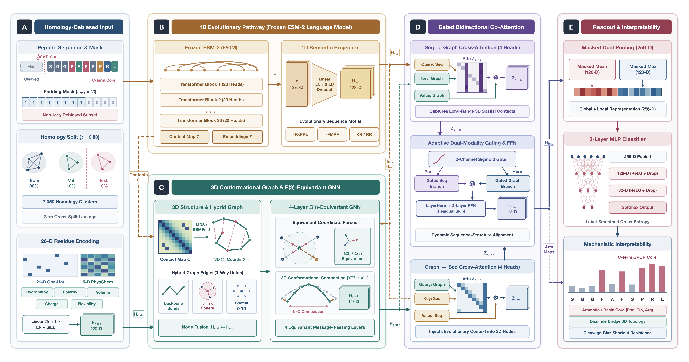

# NeuroEGNN: Structure-Aware and Interpretable Neuropeptide Identification

[](LICENSE)
[](requirements.txt)

Repository: https://github.com/raozeng/NeuroEGNN  |  License: MIT (see [`LICENSE`](LICENSE))

Official PyTorch implementation, homology-isolated benchmark splits, trained checkpoints (`best_model.pth`), experimental results, and reproducibility scripts for **NeuroEGNN** (*Structure-Aware and Interpretable Neuropeptide Identification via Equivariant 3D Graph Learning and Evolutionary Co-Attention*).

---

## 1. Model Architecture

<p align="center">
  
</p>

**Overview of the NeuroEGNN framework (`L_max = 50`, `0.917M` trainable parameters):**

* **(A) Homology-Debiased Input & Physicochemical Encoding:** Peptide sequences ($N = 8,887$) are partitioned via single-linkage sequence homology clustering at $\tau = 0.80$ ($C = 7,050$ clusters) to guarantee zero cross-split leakage and evaluated alongside a debiased Non-$\text{Met}_1$ hard subset. Each residue is encoded into a $26$-D biochemical node descriptor ($21$-D amino acid one-hot encoding plus $5$ normalized physicochemical properties: hydropathy, polarity, volume, net charge, and backbone flexibility) and projected to $128$-D node features $\mathbf{H}_{\text{node}}$.
* **(B) 1D Evolutionary Semantic Pathway (Frozen ESM-2):** The primary sequence is fed into a frozen $33$-layer `ESM-2` (`esm2_t33_650M_UR50D`) protein language model to extract contextualized per-residue evolutionary embeddings $\mathbf{E} \in \mathbb{R}^{L \times 1280}$ (projected via Linear + LayerNorm + SiLU to $\mathbf{H}_{\text{seq}} \in \mathbb{R}^{L \times 128}$) alongside an unsupervised residue-residue contact probability map $\mathbf{C} \in [0, 1]^{L \times L}$.
* **(C) 3D Conformational Graph & 4-Layer $E(3)$-Equivariant GNN:** Initial 3D $\text{C}\alpha$ coordinates $\mathbf{X}^{(0)} \in \mathbb{R}^{L \times 3}$ are deterministically reconstructed from $\mathbf{C}$ via calibrated Torgerson multidimensional scaling (MDS). A hybrid 3D spatial graph is built by taking the union of local backbone bonds ($|i - j| \le 2$), spatial cutoff edges ($d_{ij}^{(0)} < 10\,\text{\AA}$), and $8$-nearest-neighbor ($8$-NN) contacts. Four $E(3)$-equivariant message-passing layers jointly update node embeddings ($\mathbf{H}^{(0)} \to \mathbf{H}_{\text{graph}} \in \mathbb{R}^{L \times 128}$) and relax 3D coordinates ($\mathbf{X}^{(0)} \to \mathbf{X}^{(4)}$) while strictly preserving equivariance to 3D rotations, translations, and reflections.
* **(D) Gated Bidirectional Sequence-Structure Co-Attention:** A $4$-head bidirectional cross-attention module aligns 1D evolutionary semantics and 3D structural representations ($\text{Seq} \to \text{Graph}$ attention $\mathbf{A}_{\text{s}\to\text{g}}$ and $\text{Graph} \to \text{Seq}$ attention $\mathbf{A}_{\text{g}\to\text{s}}$). An adaptive per-residue two-channel sigmoid gate $(\alpha_{\text{seq}}, \alpha_{\text{graph}})$ dynamically balances the two modalities before a residual 2-layer feed-forward network (FFN) outputs fused representations $\mathbf{H}_{\text{fuse}} \in \mathbb{R}^{L \times 128}$.
* **(E) Masked Dual Pooling, Classification & Attribution:** Padding-masked mean pooling ($128$-D) and max pooling ($128$-D) are concatenated into a $256$-D global peptide descriptor and passed through a 3-layer MLP classifier ($256 \to 128 \to 32 \to 2$) trained with label-smoothed binary cross-entropy ($\varepsilon = 0.05$). Bidirectional co-attention weights provide residue- and contact-level mechanistic interpretability.

---

## 2. Repository Structure

```text
NeuroEGNN/
├── assets/
│   └── fig0_architecture.png       # High-resolution NeuroEGNN architecture diagram
├── model.py                        # NeuroEGNN (NeuroPred3D) architecture, 4-layer E(3)-EGNN, & Gated Co-Attention
├── dataset.py                      # ESM-2 featurizer, calibrated Torgerson MDS 3D reconstruction, & 3D graph builder
├── make_split.py                   # Single-linkage homology clustering (tau=0.80) & quota-balanced partitioning
├── train.py                        # Training loop with label-smoothed BCE, AdamW, CosineAnnealing, & early stopping
├── test.py                         # Hold-out evaluation & prediction export
├── run.py                          # Unified CLI entry point (prepare / train / test / all / cv)
├── run_ablation.py                 # Controlled 5-variant x 3-seed ablation runner (full, no_coord, no_attn, no_3d, no_esm)
├── run_independent_test.py         # 5-fold out-of-fold & external evaluation with zero-leakage verification
├── run_interpretability.py         # Bidirectional cross-attention extraction & residue attribution analysis
├── run_case_study.py               # Representative high-confidence & boundary peptide case selector
├── run_supplement_experiments.py   # Classical, static-3D, & PLM baseline benchmarks + length-stratified evaluation
├── run_debiased_and_relaxation.py         # SOTA predictors, Non-Met1 debiased benchmark, EGNN relaxation, & pure-NumPy inference
├── compute_clean_all.py            # Out-of-fold & hold-out statistical diagnostics (DeLong, McNemar, calibration)
├── compute_oof_interp.py           # Zero-leakage 5-fold out-of-fold co-attention aggregation (N = 8,887)
├── generate_nc_architecture.py     # Vector generator for Figure 1 (NeuroEGNN architecture diagram)
├── generate_all_figures.py         # Vector generator for Figures 2-7 and TOC graphic
├── all_data.csv                    # Deduplicated benchmark corpus (N = 8,887: 4,424 Pos / 4,463 Neg)
├── training_v2.csv                 # Hold-out training split (N = 7,110)
├── validation_v2.csv               # Hold-out validation split (N = 889)
├── testing_v2.csv                  # Hold-out independent test split (N = 888)
├── *_v2_fold{1..5}.csv             # 5-fold homology-isolated cross-validation splits (train / val / test per fold)
├── cache/
│   ├── clusters_sim0.8_*.npy       # Precomputed single-linkage homology cluster assignments (C = 7,050)
│   ├── structures/*.npy            # Precomputed calibrated Torgerson MDS 3D C-alpha coordinates (N = 8,887)
│   └── esm/testing_v2_*.npz        # Precomputed ESM-2 (650M) test cache for instant offline evaluation
├── logs/                           # Training logs for 5-fold cross-validation and ablation runs
├── results/
│   ├── 5fold/                      # 5-fold CV checkpoints (fold_0..4/best_model.pth), OOF predictions, & metrics
│   ├── ablation/                   # 15 hold-out checkpoints (5 variants x seeds 500-502/best_model.pth) & metrics
│   ├── baselines/                  # Classical, static-3D, & PLM baseline summary/per-fold CSVs & ROC/PR curves
│   ├── debiased_and_relaxation/           # SOTA comparisons, Non-Met1 hard-subset results, 3D relaxation, & manifold stats
│   └── figure_data/                # Aggregated zero-leakage OOF diagnostics & co-attention statistics
├── requirements.txt                # Python package dependencies
└── LICENSE                         # MIT License
```

---

## 3. Environment Setup

Install dependencies (Python >= 3.10 recommended):

```bash
pip install -r requirements.txt
```

> **Note on Precomputed Caches & Instant Offline Evaluation**:
> - All `8,887` calibrated 3D $\text{C}\alpha$ structures (`cache/structures/*.npy`), homology cluster IDs, and the independent hold-out ESM-2 (650M) test cache (`cache/esm/testing_v2_t33_650M_L50.npz`) are included directly in this repository, enabling **instant CPU evaluation and interpretability analysis on `testing_v2.csv`** without downloading the 650M language model.
> - Full training ESM-2 caches (`cache/esm/training_v2*.npz`, >100 MB each) are automatically extracted and cached on first run via `ensure_caches()` in `dataset.py` (or via `python run.py --mode prepare --esm_model esm2_t33_650M_UR50D`).
> - All 20 trained PyTorch checkpoints (`results/5fold/.../best_model.pth` and `results/ablation/.../best_model.pth`) are included.

---

## 4. Quick Start & Reproducing Experiments

### 4.1 Instant Hold-Out Evaluation Using Included Checkpoints ($N = 888$)
```bash
# Evaluate pretrained hold-out NeuroEGNN (seed 500) on testing_v2.csv
python test.py \
    --model_path results/ablation/full/seed_500/train/best_model.pth \
    --test_csv testing_v2.csv
```

### 4.2 Homology-Isolated Dataset Partitioning ($\tau = 0.80$)
```bash
# Regenerate 80/10/10 hold-out splits (training_v2.csv, validation_v2.csv, testing_v2.csv)
python make_split.py --sim 0.8 --seed 500

# Regenerate 5-fold homology-isolated cross-validation splits (*_v2_fold{1..5}.csv)
python make_split.py --sim 0.8 --folds 5 --seed 500
```

### 4.3 5-Fold Homology-Isolated Cross-Validation ($N = 8,887$)
```bash
python run.py --mode cv --folds 5 --esm_model esm2_t33_650M_UR50D --epochs 50 --batch_size 128 --lr 5e-4

# Out-of-fold evaluation (each fold model evaluated strictly on its own held-out fold)
python run_independent_test.py
```
> Hold-out results reported in the paper use the hold-out models in `results/ablation/full/seed_*/`; the 5-fold models must not be evaluated on `testing_v2.csv`.

### 4.4 Hold-Out Training & Multi-Seed Component Ablation ($N = 888$)
```bash
# Train & evaluate all 5 variants (full, no_coord, no_attn, no_3d, no_esm) across seeds 500, 501, 502
python run_ablation.py --esm_model esm2_t33_650M_UR50D --seeds 500 501 502 --epochs 50
```

### 4.5 Zero-Leakage Cross-Attention Interpretability
```bash
python run_interpretability.py \
    --model_path results/ablation/full/seed_500/train/best_model.pth \
    --test_csv testing_v2.csv
```

### 4.6 Baselines, Non-$\text{Met}_1$ Debiased Evaluation & 3D Coordinate Relaxation
```bash
python run_supplement_experiments.py
python run_debiased_and_relaxation.py
```

### 4.7 Regenerating Publication Figures
```bash
python generate_nc_architecture.py
python generate_all_figures.py
```

---

## License
Released under the MIT License (see [`LICENSE`](LICENSE)).

## Contact
Ziqiang Luo (`luoziqiang@hainnu.edu.cn`) and Rao Zeng (`rao.zeng@hainnu.edu.cn`), Hainan Normal University.
