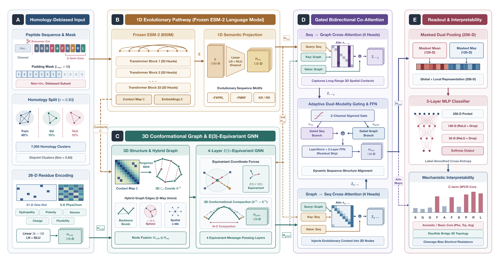

# NeuroEGNN: Structure-Aware and Interpretable Neuropeptide Identification

[](LICENSE)
[](requirements.txt)

Repository: https://github.com/raozeng/NeuroEGNN  |  License: MIT (see [`LICENSE`](LICENSE))

PyTorch implementation, homology-isolated benchmark splits, trained checkpoints (`best_model.pth`), experimental outputs, and figure generation scripts for **NeuroEGNN** (*Structure-Aware and Interpretable Neuropeptide Identification via Equivariant 3D Graph Learning and Evolutionary Co-Attention*).

---

## 1. Model Overview

<p align="center">
  
</p>

**Architecture components (`L_max = 50`, `0.917M` trainable parameters):**

* **(A) Homology-Isolated Partitioning & Biochemical Node Encoding:** Peptide sequences ($N = 8,887$) are grouped via single-linkage sequence clustering at identity threshold $\tau = 0.80$ ($C = 7,050$ clusters) to prevent high-identity ($\ge 80\%$) overlap across splits, alongside a debiased Non-$\text{Met}_1$ evaluation subset. Each residue is represented by a $26$-D node feature vector ($21$-D amino acid one-hot encoding plus $5$ normalized physicochemical properties: hydropathy, polarity, volume, net charge, and backbone flexibility) projected to $128$-D.
* **(B) 1D Evolutionary Pathway (Frozen ESM-2):** Each sequence is encoded by a frozen $33$-layer `ESM-2` (`esm2_t33_650M_UR50D`) language model to obtain contextualized per-residue embeddings $\mathbf{E} \in \mathbb{R}^{L \times 1280}$ (projected to $\mathbf{H}_{\text{seq}} \in \mathbb{R}^{L \times 128}$) and an unsupervised residue-residue contact probability map $\mathbf{C} \in [0, 1]^{L \times L}$.
* **(C) 3D Backbone Graph & 4-Layer $E(3)$-Equivariant GNN:** Initial 3D $\mathrm{C}\alpha$ coordinates $\mathbf{X}^{(0)} \in \mathbb{R}^{L \times 3}$ are reconstructed offline from $\mathbf{C}$ via physically calibrated Torgerson multidimensional scaling (MDS). Residue graphs combine local backbone connectivity ($|i - j| \le 2$), spatial cutoff edges ($d_{ij}^{(0)} < 10\,\text{\AA}$), and symmetric $8$-nearest spatial neighbors. Four $E(3)$-equivariant graph layers update node representations ($\mathbf{H}^{(0)} \to \mathbf{H}_{\text{graph}} \in \mathbb{R}^{L \times 128}$) and coordinates ($\mathbf{X}^{(0)} \to \mathbf{X}^{(4)}$) while preserving rigid-body rotational, translational, and reflectional equivariance.
* **(D) Gated Bidirectional Sequence-Structure Co-Attention:** A $4$-head bidirectional cross-attention module couples 1D sequence embeddings and 3D graph representations ($\mathbf{A}_{\text{s}\to\text{g}}$ and $\mathbf{A}_{\text{g}\to\text{s}}$) using a learnable per-residue two-channel sigmoid gate followed by a residual feed-forward network ($\mathbf{H}_{\text{fuse}} \in \mathbb{R}^{L \times 128}$).
* **(E) Masked Dual Pooling, Classification & Attribution:** Masked mean pooling ($128$-D) and max pooling ($128$-D) are concatenated into a $256$-D global representation and classified by a 3-layer MLP ($256 \to 128 \to 32 \to 2$) trained with label-smoothed binary cross-entropy ($\varepsilon = 0.05$).

---

## 2. Repository Structure

```text
NeuroEGNN/
├── assets/
│   └── fig0_architecture.png              # NeuroEGNN architecture overview diagram
├── model.py                               # NeuroEGNN, 4-layer E(3)-EGNN, and gated bidirectional co-attention
├── dataset.py                             # ESM-2 feature caching, calibrated Torgerson MDS, and 3D graph dataset
├── make_split.py                          # Single-linkage homology clustering (tau=0.80) and quota-balanced splits
├── train.py                               # Training loop with label-smoothed BCE, AdamW, and early stopping
├── test.py                                # Checkpoint evaluation and prediction export
├── run.py                                 # Unified CLI entry point (prepare / train / test / all / cv)
├── run_ablation.py                        # Multi-seed component ablation runner (full, no_coord, no_attn, no_3d, no_esm)
├── run_independent_test.py                # 5-fold out-of-fold and external dataset evaluation
├── run_interpretability.py                # Bidirectional cross-attention extraction and heatmaps
├── run_case_study.py                      # Representative prediction case selector
├── run_supplement_experiments.py          # Classical 1D, static 3D, and pooled PLM baselines + length stratification
├── run_debiased_and_relaxation.py         # Published predictor benchmarks, Non-Met1 subset, and EGNN relaxation analysis
├── compute_clean_all.py                   # Dataset statistics, Rg-normalized RMSD, and DeLong/McNemar tests
├── compute_oof_interp.py                  # 5-fold out-of-fold co-attention aggregation (N = 8,887)
├── generate_nc_architecture.py            # Vector renderer for Figure 1 (architecture diagram)
├── generate_all_figures.py                # Vector renderer for Figures 2-6, Figure 8, and TOC graphic
├── render_pymol_peptides.py               # Open-Source PyMOL ray-tracer for all-atom ESMFold conformers
├── generate_fig6_3d_interpretability.py   # Compositor for Figure 7 (all-atom 3D motif attribution)
├── all_data.csv                           # Deduplicated benchmark corpus (N = 8,887: 4,424 Pos / 4,463 Neg)
├── training_v2.csv                        # Hold-out training split (N = 7,110)
├── validation_v2.csv                      # Hold-out validation split (N = 889)
├── testing_v2.csv                         # Hold-out independent test split (N = 888)
├── *_v2_fold{1..5}.csv                    # 5-fold homology-isolated cross-validation splits
├── cache/
│   ├── clusters_sim0.8_*.npy              # Precomputed single-linkage homology cluster IDs (C = 7,050)
│   ├── structures/*.npy                   # Precomputed calibrated MDS 3D C-alpha coordinates (N = 8,887)
│   └── esm/testing_v2_*.npz               # Precomputed ESM-2 (650M) hold-out test cache
├── logs/                                  # Training logs for 5-fold CV and hold-out ablations
├── results/
│   ├── 5fold/                             # 5-fold CV checkpoints (fold_0..4/best_model.pth), OOF predictions, and metrics
│   ├── ablation/                          # 15 hold-out checkpoints (5 variants x seeds 500-502/best_model.pth) and metrics
│   ├── baselines/                         # Classical 1D, static 3D, and pooled PLM baseline summaries
│   ├── debiased_and_relaxation/           # Published predictor results, Non-Met1 subset metrics, and relaxation stats
│   ├── figure_data/                       # Out-of-fold diagnostics, co-attention summaries, and ESMFold PDBs
│   └── pymol_sessions/                    # PyMOL sessions (.pse), camera metadata, and rendered conformer panels
├── requirements.txt                       # Python dependencies
└── LICENSE                                # MIT License
```

---

## 3. Environment Setup

Install dependencies (Python >= 3.10 recommended):

```bash
pip install -r requirements.txt
```

* Precomputed 3D $\mathrm{C}\alpha$ coordinates (`cache/structures/*.npy`), homology cluster assignments, and the hold-out ESM-2 (650M) test cache (`cache/esm/testing_v2_t33_650M_L50.npz`) are included in the repository for direct offline CPU evaluation on `testing_v2.csv`.
* Training ESM-2 caches (`cache/esm/training_v2*.npz`) are generated automatically on first run via `ensure_caches()` in `dataset.py` (or `python run.py --mode prepare --esm_model esm2_t33_650M_UR50D`).
* All 20 trained checkpoints (`results/5fold/.../best_model.pth` and `results/ablation/.../best_model.pth`) are included.

---

## 4. Usage & Reproducing Results

### 4.1 Hold-Out Evaluation Using Included Checkpoints ($N = 888$)
```bash
python test.py \
    --model_path results/ablation/full/seed_500/train/best_model.pth \
    --test_csv testing_v2.csv
```

### 4.2 Homology-Isolated Dataset Partitioning ($\tau = 0.80$)
```bash
# 80/10/10 cluster-isolated hold-out splits
python make_split.py --sim 0.8 --seed 500

# 5-fold cluster-isolated cross-validation splits
python make_split.py --sim 0.8 --folds 5 --seed 500
```

### 4.3 5-Fold Homology-Isolated Cross-Validation ($N = 8,887$)
```bash
python run.py --mode cv --folds 5 --esm_model esm2_t33_650M_UR50D --epochs 50 --batch_size 128 --lr 5e-4

# Out-of-fold evaluation across the 5 held-out folds
python run_independent_test.py --eval_mode fold_test
```
> Hold-out benchmark metrics in the paper use the models trained on `training_v2.csv` (`results/ablation/full/seed_*/`); the 5-fold checkpoints are evaluated strictly out-of-fold on their respective `testing_v2_fold{1..5}.csv` splits.

### 4.4 Multi-Seed Component Ablation ($N = 888$)
```bash
python run_ablation.py --esm_model esm2_t33_650M_UR50D --seeds 500 501 502 --epochs 50
```

### 4.5 Cross-Attention Interpretability
```bash
python run_interpretability.py \
    --model_path results/ablation/full/seed_500/train/best_model.pth \
    --test_csv testing_v2.csv
```

### 4.6 Baselines, Non-$\text{Met}_1$ Debiased Evaluation & 3D Coordinate Relaxation
```bash
python run_supplement_experiments.py
python run_debiased_and_relaxation.py
```

### 4.7 Regenerating Manuscript Figures
```bash
python generate_nc_architecture.py
python generate_all_figures.py
uv run render_pymol_peptides.py
python generate_fig6_3d_interpretability.py
```

---

## License
Released under the MIT License (see [`LICENSE`](LICENSE)).

## Contact
Ziqiang Luo (`luoziqiang@hainnu.edu.cn`) and Rao Zeng (`rao.zeng@hainnu.edu.cn`), Hainan Normal University.
